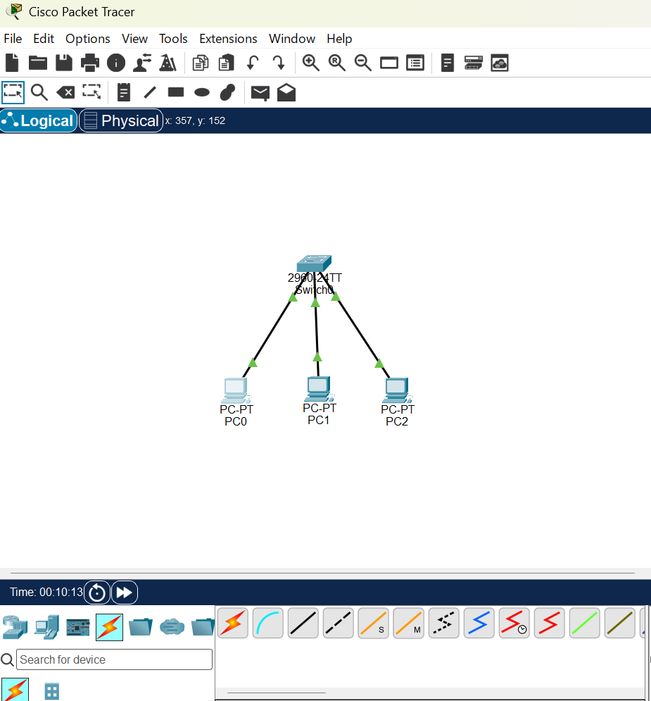
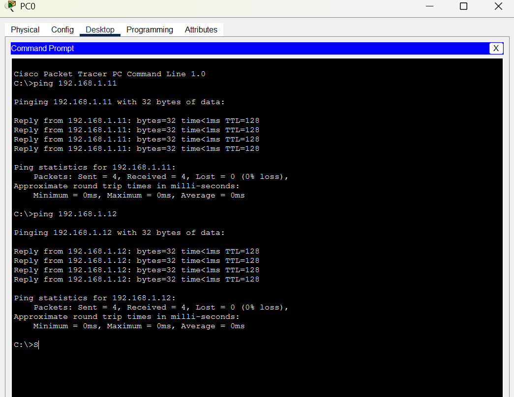
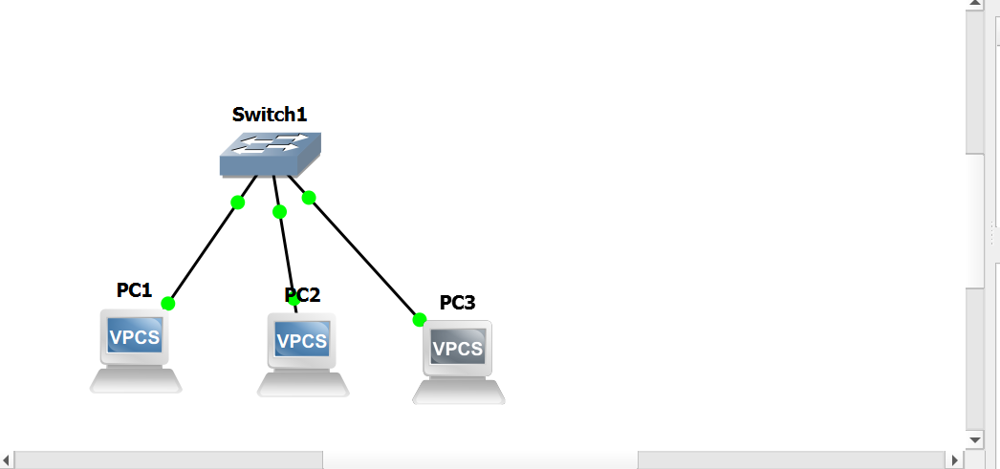
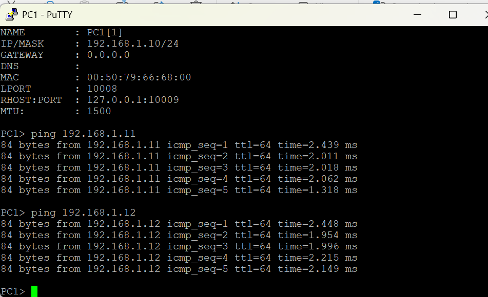

# Basic Network Simulation Lab: Packet Tracer and GNS3

Week 1 task of the Network Administration Internship at IT-SIMPLERA Solutions. A networking lab where I built the same small network in two simulators, **Cisco Packet Tracer** and **GNS3**, and verified connectivity with ping.

**Author:** Nazish Ahmad

## Overview

The lab uses a simple star topology: three PCs connected to one switch, all in the same subnet. Because every host is in `192.168.1.0/24`, no router or default gateway is needed. The goal was to confirm that hosts in the same subnet can reach each other through a switch, and to compare how the two tools behave.

| Item | Details |
|------|---------|
| Topology | Star: 3 PCs connected to 1 switch |
| Network | 192.168.1.0/24 |
| Packet Tracer | PC-PT end devices, 2960-24TT switch |
| GNS3 | VPCS virtual PCs, switch, PuTTY console |
| PC1 (GNS3) | 192.168.1.10/24, gateway 0.0.0.0 |
| Ping targets | 192.168.1.11 and 192.168.1.12 |

## Results

| Simulator | Source | Targets | Replies | Packet loss |
|-----------|--------|---------|---------|-------------|
| Cisco Packet Tracer | PC1 | 192.168.1.11, 192.168.1.12 | 4/4 each | 0% |
| GNS3 (VPCS) | PC1 | 192.168.1.11, 192.168.1.12 | 5/5 each | 0% |

### Cisco Packet Tracer

### GNS3

## Observations

- Packet Tracer reports replies under 1 ms with TTL 128, since it simulates traffic and its PCs mimic Windows defaults.
- GNS3 with VPCS shows round-trip times of roughly 1.3 to 2.4 ms with TTL 64, because it passes real emulated traffic and VPCS behaves like a Linux-style host.
- The first ping in each lab triggers ARP, after which the switch forwards frames only to the correct port.

## How to Reproduce

1. Add three PCs and one switch to the workspace and connect each PC to the switch.
2. Assign IP addresses in `192.168.1.0/24` to each PC (for example `.10`, `.11`, `.12`).
3. Make sure the links are up (green indicators).
4. From the first PC, run `ping 192.168.1.11` and `ping 192.168.1.12`.

In GNS3, set the address on a VPCS node with `ip 192.168.1.10/24`.

## Challenges

Most of the difficulty was getting GNS3 set up. My download request was delayed by up to two business days, the GitHub releases link returned a 404 error, I had to work out which installer was the correct stable version, and I had trouble getting the PuTTY console to open for the VPCS nodes. Once those were resolved, the lab itself went smoothly.

## Tools

- Cisco Packet Tracer
- GNS3
- VPCS
- PuTTY

## Repository Contents

- `Report.pdf`: the full write-up
- `Cisco Packet Tracer.pkt`: Packet Tracer project file
- `GNS3 Project/`: GNS3 project
- `Screenshots/`: topology and ping screenshots
- `Post on linkedin/`: text of the LinkedIn post
